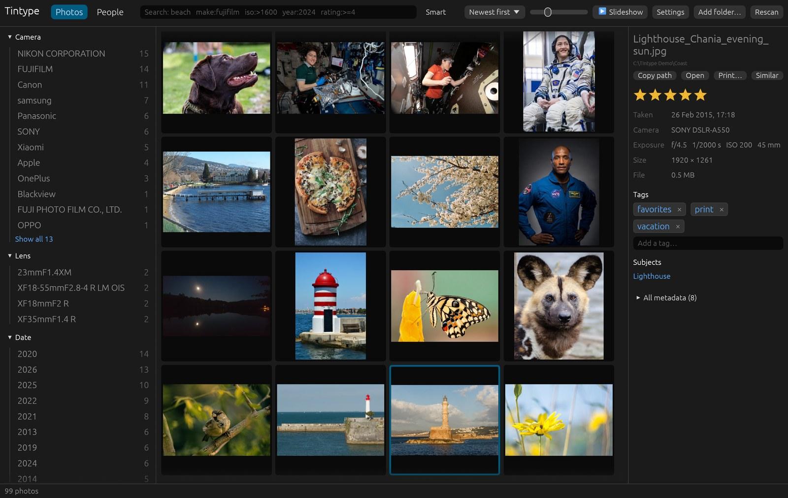

# Tintype user guide

Tintype indexes the photos you already have, wherever they are, and helps you find,
rate, tag and sort them. It never changes, moves or deletes a photo, and everything
runs on your computer: nothing is uploaded.

1. [Getting started](getting-started.md): install, add your folders, keep them up to date
2. [Browsing](browsing.md): the grid, filters, the full-size view, stacks, the slideshow
3. [Searching](searching.md): search terms, smart search, subjects, similar photos
4. [People](people.md): find faces, name people, confirm suggestions
5. [Ratings, tags and sidecars](ratings-and-tags.md): your own metadata, and Best photos first
6. [Command line](command-line.md): `tintype-cli` for scripting

The photos in these screenshots are public domain: see [photo credits](photo-credits.md).
