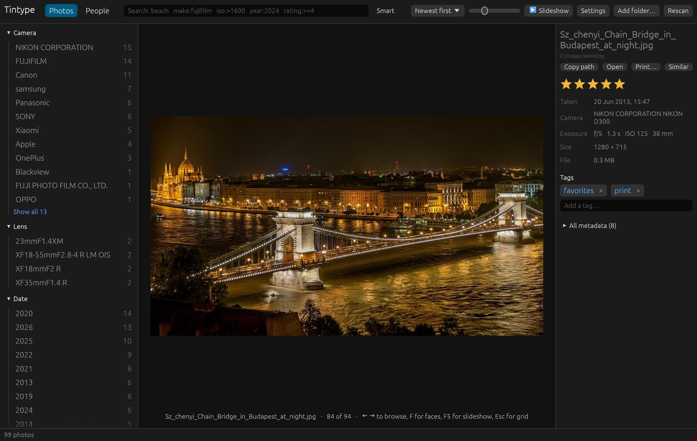
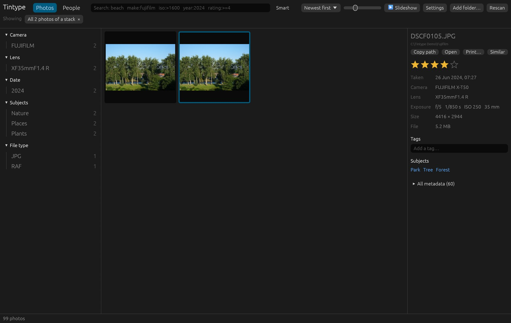
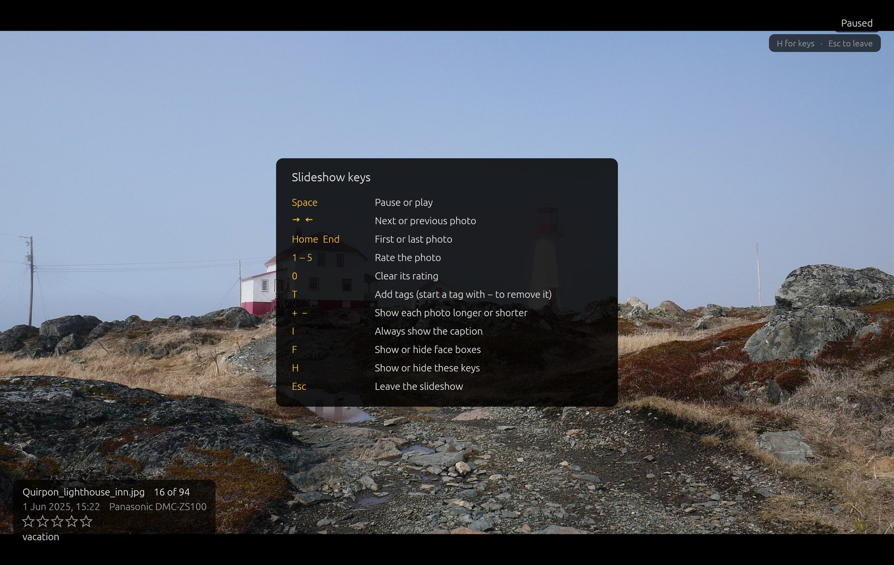

# Browsing

## The grid

The middle of the window shows your photos, newest first. Change the order with the
sort menu, and the thumbnail size with the slider beside it.

Click a photo to select it, or move with the arrow keys (**Home** and **End** jump to the
first and last). The panel on the right shows its details: when and with which camera it
was taken, its exposure, size and file, your rating and tags, the subjects Tintype
found, and the people in it. **All metadata** lists every EXIF field.

## Select several photos

**Ctrl+click** photos to add them to the selection, or to take them out again;
**Shift+click** selects every photo from the last one clicked to this one, and **Ctrl+A**
selects all the results. The details panel then says how many are selected, and below
that shows the last photo clicked. Ratings and tags still apply to that one photo.
**Clear** or **Esc** goes back to one photo. A stack counts as the photo it shows.

## Show in folder, to upload

To upload photos to Google Photos, Flickr or any other site, select them and click
**Show in folder** in the details panel. Your file manager opens with them selected:
drag them onto the site's upload page in your browser.

When the photos are in different folders, Tintype first copies them into one folder of
its own (**Tintype Upload**, in your temporary files), so you can drag them all at once.
Two files with the same name are kept apart as `DSCF1234.JPG` and `DSCF1234 (2).JPG`.
The copies from last time are removed when you do this again. Your photos themselves are
only read, never moved or changed. For a RAW + JPEG stack, the photo shown is used: the
JPEG, which is what upload sites want, unless you rated the RAW higher.

On Linux, the folder opens without the photos selected.

## Filters

The sidebar counts your photos by camera, lens, date, tag, subject, person, file type
and folder. Click a value to show only those photos; click more to narrow further. The
filters you've chosen show above the grid; click one to remove it.

Filters combine with the [search box](searching.md), so you can pick a camera in the
sidebar and type `iso:>1600` to see its high-ISO shots.

## Full-size view

Double-click a photo, or press **Enter**, to see it full size. **←** and **→** (or
**Space** and **Backspace**) browse, and **Esc** goes back to the grid.

Press **F** to show or hide face boxes, with the names of people you've named.

## Stacks

Tintype shows several files of one shot as a single photo with a count badge:

- exact copies
- RAW + JPEG pairs, edits and exports of the same capture
- burst frames taken a few seconds apart that look alike
- repeats of the same frame within a minute

The photo shown is the best rated one, else the sharpest of a burst, else the largest.
Click the badge, or **Show all** in the details, to see every photo in the stack.
Stacking only changes what you see; nothing on disk changes.

Bursts and repeats need **Analyze photos** to have run. Photos taken at different times
are never stacked, however alike they look.

## Open and print

**Open** in the details panel (or **Ctrl+O**, **⌘O** on a Mac) opens the photo in your
default app. On Windows, **Print…** (**Ctrl+P**) opens the Windows print dialog; on
macOS and Linux, open the photo and print from the viewer. **Copy path** copies the
file's location.

## Slideshow

Click **▶ Slideshow** or press **F5** to show the current results full screen, from the
selected photo.

| Key | |
|-----|-|
| Space | Pause or play |
| ← → | Previous or next photo |
| Home, End | First or last photo |
| 1–5, 0 | Rate the photo, or clear its rating |
| T | Add tags (Tab completes; start a tag with `-` to remove it) |
| + − | Show each photo longer or shorter |
| I | Always show the caption |
| F | Show or hide face boxes |
| H | Show or hide the list of keys |
| Esc | Leave the slideshow |

A click on the right half of the screen goes forward, on the left half back.

## Keyboard shortcuts

| Key | |
|-----|-|
| Arrow keys, Home, End | Move the selection |
| Ctrl+click, Shift+click | Select several photos |
| Ctrl+A | Select all the results |
| Enter | Open the selected photo full size |
| Esc | Back to the grid, or back to one selected photo |
| 0–5 | Rate the selected photo (0 clears) |
| Ctrl+F | Go to the search box |
| Ctrl+O | Open in your default app |
| Ctrl+P | Print (Windows) |
| F5 | Slideshow |

On a Mac, use ⌘ instead of Ctrl.
