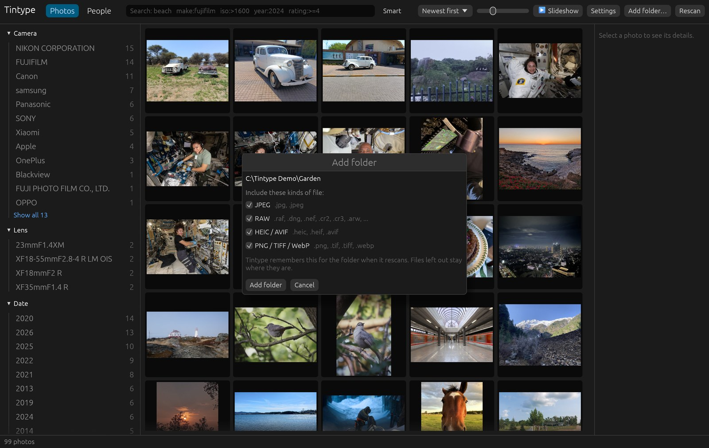

# Getting started

## Install

Download the installer for your system from
[Releases](https://github.com/ppound/tintype/releases/latest):

| System | File |
|--------|------|
| Windows 10/11 | `tintype_<version>_x64-setup.exe`, installs for your user only, no administrator rights |
| macOS 11+, Apple Silicon | `Tintype_<version>_aarch64_macos-arm64.dmg` |
| macOS 11+, Intel | `Tintype_<version>_x64_macos-x64.dmg` |
| Linux, any distribution | `tintype_<version>_x86_64.AppImage` |
| Debian, Ubuntu | `tintype_<version>_amd64.deb` |

The builds aren't code-signed yet, so the first launch shows a warning:

- **Windows**: "Windows protected your PC". Click **More info**, then **Run anyway**.
- **macOS**: "Apple could not verify Tintype". Open **System Settings › Privacy & Security**,
  scroll down and click **Open Anyway**. If macOS says the app "is damaged", run
  `xattr -dr com.apple.quarantine /Applications/Tintype.app` once in Terminal.
- **Linux**: `chmod +x tintype_*.AppImage`, then run it.

## Add your photos

Click **Add folder…** and pick a folder. Tintype includes the folders inside it too.

Choose which kinds of file to include: JPEG, RAW, HEIC/AVIF and PNG/TIFF/WebP. If your
camera saves RAW + JPEG pairs, you can add the folder as JPEG only, for example. Tintype
remembers the choice for that folder, and a folder inside it can have its own.

The first scan reads every photo; later scans only read new and changed files. Add as
many folders as you like, on any drive, including network drives.

## Keep it up to date

Click **Rescan** after adding, changing or removing photos. Moving or renaming photos
inside your folders is fine: Tintype recognizes a file by its content and keeps its
rating, tags and people.

A photo that can't be read (a disconnected drive, for example) is never treated as
deleted. Only photos that are really gone are removed from the catalog.

## Downloads on first use

The features that look at what's in your photos use open models. Each one downloads
once, the first time you use its feature, and is checked against a known fingerprint
(SHA-256) before use:

| Feature | Model | Size |
|---------|-------|------|
| [People](people.md) | YuNet + SFace | 39 MB |
| [Smart search, subjects, similar photos](searching.md), burst stacks | SigLIP B/16 | 815 MB |
| [Aesthetic score](ratings-and-tags.md#best-photos-first) (optional) | CLIP ViT-L/14 + LAION predictor | 1.2 GB |

Before smart search, subjects and similar photos work, Tintype looks at each photo once
(**Analyze photos**, about 0.15 s per photo). It runs in the background in batches, and
the app stays usable while it does.

## Where Tintype keeps its data

The catalog, search index and thumbnail cache live in your user data folder
(`%APPDATA%\Tintype\data\library` on Windows). Your photos stay where they are. The only
files Tintype writes next to them are [sidecars](ratings-and-tags.md#sidecars), and you
can turn those off.

If Tintype ever crashes, details are written to `crash.log` in the library folder.
Please [open an issue](https://github.com/ppound/tintype/issues) with it.
