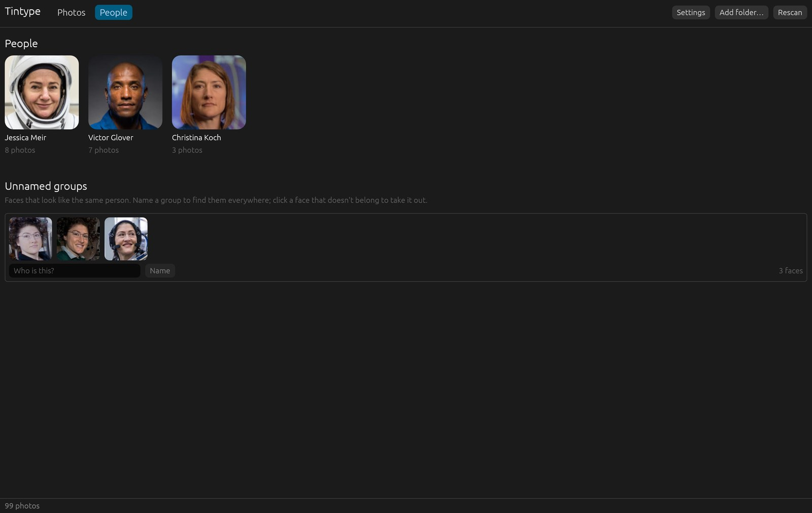
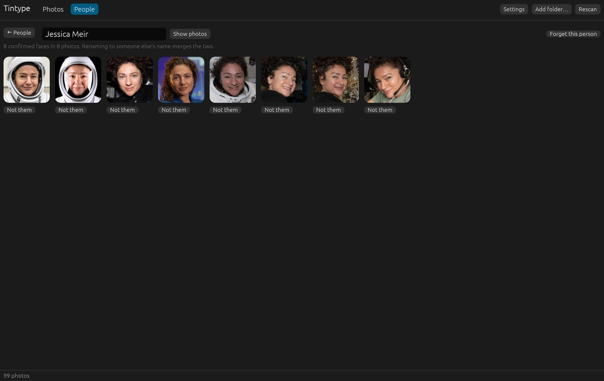
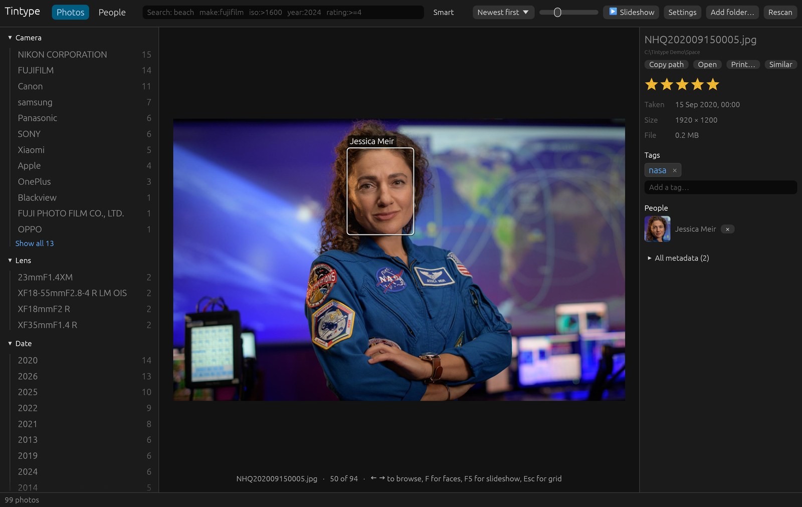

# People

Tintype finds the faces in your photos, groups the ones that look like the same person,
and lets you name each group once. Face recognition runs on your computer: no photo or
face leaves it.

## Find faces

Open the **People** tab and click **Find faces**. Tintype downloads its two small face
models (39 MB) the first time, then checks your photos in batches of 150. The app stays
usable while it runs, and the groups appear as they form. When you add photos later, the
People tab says how many haven't been checked yet; click **Find faces** again.

## Name people

Under **Unnamed groups**, each row is a set of faces that look like the same person.
If a face doesn't belong, click it to take it out. Type a name in **Who is this?** and
click **Name**. Naming a group with a name you've already used adds its faces to that
person.

Once someone is named, Tintype suggests them for new faces that match. Confirm a
suggestion, or say it's someone else.

## A person's page

Click a person to see all their faces.

- **Show photos** shows their photos in the grid (the same as clicking them under
  **People** in the sidebar, or searching `person:"jessica meir"`).
- **Not them** takes a face away from this person.
- Edit the name to rename them. Renaming to someone else's name merges the two.
- **Forget this person** makes their faces unnamed again.

## Faces in photos

The details panel lists the people in the selected photo; × takes one out. In the
full-size view, **F** shows a box around each face with its name.

People are saved in [sidecars](ratings-and-tags.md#sidecars) as names in the photo.
Sidecars from PhotoStat bring their people with them.

## Good to know

- Tintype prefers to split one person into two groups rather than mix two people in one,
  since naming two groups the same merges them, but separating mixed faces means
  taking them out one by one.
- Very small, blurred or turned-away faces are often not found, or not grouped.
- DNG and HEIC photos aren't checked for faces yet.
