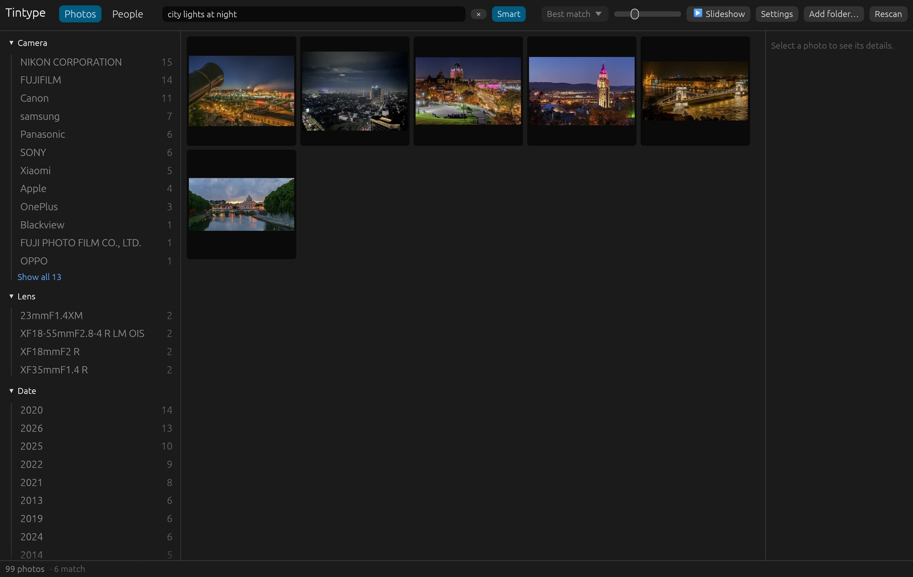
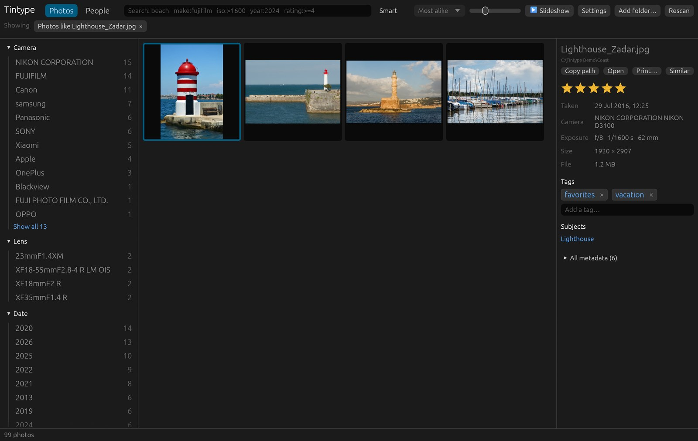

# Searching

Type in the search box at the top and press **Enter**. Every term must match.

## Search terms

| Search | Finds |
|--------|-------|
| `beach sunset` | words anywhere: file path, EXIF values, tags, subjects |
| `make:canon` `model:x-t5` `lens:23mm` `filename:dscf` | one field |
| `iso:>1600` `aperture:<=2.8` `focal:[70 TO 200]` `shutter:<0.002` | number ranges |
| `year:2024` `year:[2019 TO 2021]` | the year a photo was taken |
| `rating:>=4` `tag:family` | your own ratings and tags |
| `subject:dog` | [subjects](#subjects) Tintype found |
| `person:ada` `faces:>=3` | [people](people.md) you've named, and the number of faces |
| `gps:true` | photos with a location |
| `like:12` | [similar photos](#similar-photos) to photo 12 |
| `aesthetic:>=6` | the [aesthetic score](ratings-and-tags.md#best-photos-first), when turned on (most photos score 4–7) |

Searches combine with the filters in the sidebar.

## Smart search

Turn on **Smart** beside the search box and describe what's in the picture: "dog on a
beach", "red car at night", "city lights at night". The best matches come first, and
photos far behind the best match are left out.

Terms with a field still filter as usual, so `year:2024 kids playing in snow` looks for
snowy play among 2024's photos only.

Smart search needs each photo to have been looked at once. When you turn on **Smart**,
Tintype says how many photos it hasn't looked at yet and how long that takes; click
**Analyze photos**.

## Subjects

While analyzing, Tintype also tags photos with what they show, from a list of 150
(Animals › Dog, Nature › Beach, Buildings › Lighthouse, Events › Wedding…). They appear
in the sidebar under **Subjects** and in the details panel; click one to see every photo
with it, or search `subject:dog`. Plain words match them too.

Subjects are kept apart from your own tags and never written to sidecars. Tintype
prefers missing a subject to adding a wrong one, so small or partly hidden things are
often missed, and some scenes can't be told apart (sunrise from sunset, for example).

## Similar photos

Select a photo and click **Similar** in the details panel to see the photos that look
most like it, from anywhere in your library, most alike first.

The sidebar's filters narrow them, to one year or one camera, for example. Click the ×
on **Photos like …** to go back to your search. Similar needs **Analyze photos** to have
run.
